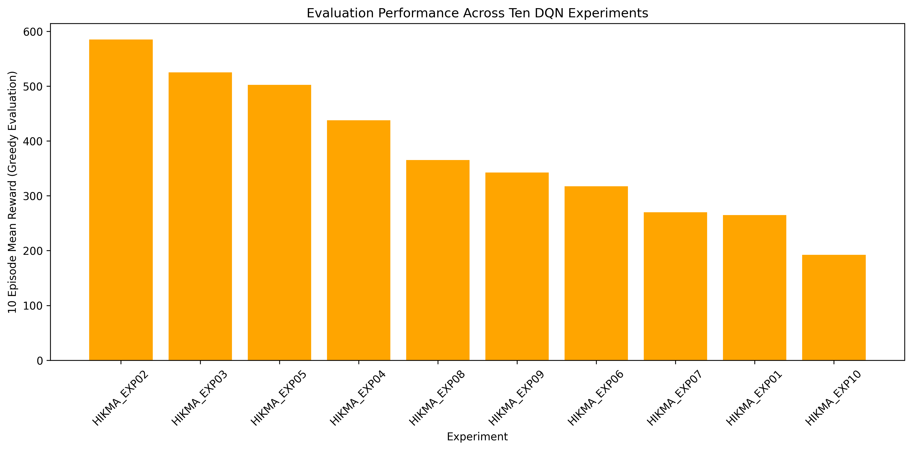
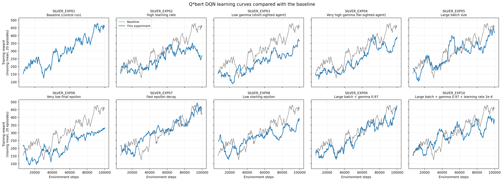
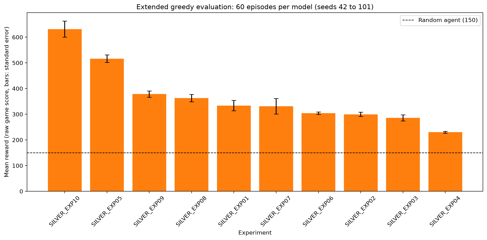
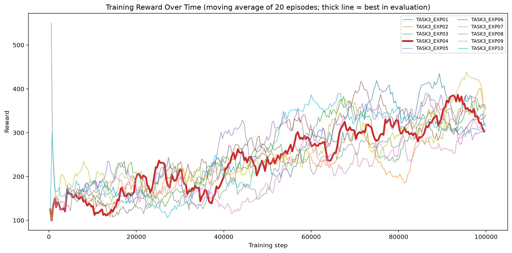
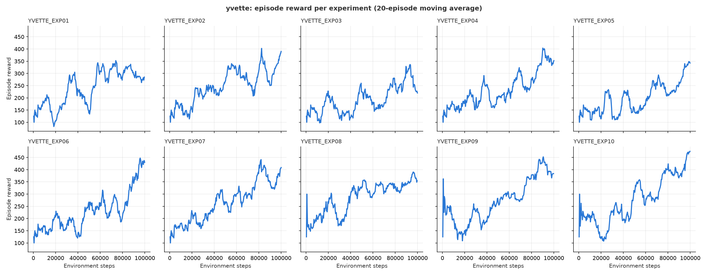

# Deep Q-Learning: Teaching an AI Agent to Play Q*bert

## About the Project

This project was completed as part of the Reinforcement Learning course at the African Leadership University (ALU).

Our team implemented a **Deep Q-Network (DQN)** agent to learn how to play the Atari game **Q*bert**. Instead of being given instructions on how to play, the agent learns through trial and error, using rewards from the game to improve its decisions over time.

The project allowed us to explore how reinforcement learning works in practice, from processing game images and building a neural network to training, evaluating and comparing different experiments.

## Our Team

- Hikma Hamza
- Nshuti Shalom Silver Jr
- Ivan Manzi
- Yvette Uwimpaye

## The Game: Q*bert

Q*bert is an Atari arcade game in which the player controls a character that jumps across a pyramid of cubes. The objective is to change the colours of the cubes while avoiding enemies and obstacles.

Our goal was to build an agent that could learn to play the game by interacting with the environment and maximising its rewards.

## How Our DQN Agent Works

The agent receives visual observations from the game and uses a Convolutional Neural Network (CNN) to estimate the value of its available actions.

We prepared the game observations by:

- Converting frames to grayscale.
- Resizing frames to 84 × 84 pixels.
- Stacking four consecutive frames to provide information about movement.
- Normalising pixel values.

The resulting observation has four stacked frames, each measuring 84 × 84 pixels.

### Training Process

Our implementation uses the following components:

- **Deep Q-Network:** A CNN that estimates the expected value of available actions.
- **Epsilon-greedy exploration:** Allows the agent to explore different actions before gradually relying more on what it has learned.
- **Experience replay:** Stores previous experiences and samples batches for training.
- **Target network:** Helps stabilise learning by providing separate target Q-value estimates.
- **Bellman equation:** Used to calculate target values for updating the agent.
- **Huber loss and Adam optimiser:** Used to train the neural network.

The agent repeatedly observes the game, selects an action, receives a reward, stores the experience and learns from previous experiences.

## Our Experiment Results

Each team member conducted multiple training experiments and evaluated their best-performing model.

| Team member | Best experiment | Evaluation mean reward |
|---|---|---:|
| Hikma | HIKMA_EXP02 | 585.0 |
| Silver | SILVER_EXP10 | 592.5 |
| Ivan | TASK3_EXP04 | 485.0 |
| Yvette | YVETTE_EXP10 | 432.5 |

Silver's best model also achieved an average reward of **631.2** over an extended 60-episode evaluation.

These results come from individual experiments. Evaluation seeds and protocols were not identical across all team members, so the figures should not be treated as a strict head-to-head comparison.

### Hikma's Results



### Silver's Results





### Ivan's Results



### Yvette's Results



### DQN Network Architecture

The diagram below illustrates how our DQN agent processes game observations and produces action-value estimates.


The network receives four stacked grayscale frames (84 × 84), processes them through three convolutional layers, and passes the extracted features through a fully connected layer with 512 neurons. The output layer produces six Q-values, which the agent uses to select its next action.

### Training Process

Our implementation uses the following components:

## Gameplay Demonstrations

This shows our trained agents playing Q*bert.


https://youtu.be/w7my37RaIfc


## Project Structure

The repository contains the implementation, experiment records, evaluation plots, saved models and gameplay demonstrations.

- `dqn.py` — Defines the neural network architecture.
- `dqn_agent.py` — Contains the DQN agent and learning logic.
- `environment.py` — Sets up the Q*bert game environment.
- `replay_buffer.py` — Stores and samples previous experiences.
- `train.py` — Runs agent training.
- `play.py` — Loads a trained model and lets it play.
- `run_experiments.py` — Runs training experiments.
- `evaluate_experiments.py` — Evaluates trained models.
- `plot_results.py` — Generates experiment visualisations.
- `demo/` — Contains gameplay demonstrations.
- `experiments/` and `plots/` — Contain experiment results, reports and visualisations.
- `models/` — Contains saved model checkpoints.

## Getting Started

### Requirements

- Python 3.11
- [uv](https://docs.astral.sh/uv/) for Python environment and dependency management
- Git

### 1. Clone the repository

```bash
git clone https://github.com/Hikma-codes/Formative-3---DQN-Atari-Project.git
```

### 2. Enter the project directory

```bash
cd Formative-3---DQN-Atari-Project
```

### 3. Install the project dependencies

```bash
uv sync --locked
```

### 4. View available training and playback options

```bash
uv run python train.py --help
```

```bash
uv run python play.py --help
```

### 5. Play using a trained model

For example, to watch Silver's best saved agent:

```bash
uv run python play.py --model experiments/silver/models/SILVER_EXP10.pth
```

### 6. Run the tests

```bash
uv run python test_dqn.py
```

```bash
uv run python test_environment.py
```

```bash
uv run python test_learning.py
```

## Team Contributions

| Team member | Main contributions |
|---|---|
| Hikma Hamza | Game environment, observation preprocessing and CNN architecture |
| Nshuti Shalom Silver Jr | Experience replay, epsilon-greedy exploration, Bellman updates, loss function and target network |
| Ivan Manzi | Training pipeline, integration, logging and checkpoint saving |
| Yvette Uwimpaye | Model evaluation, gameplay demonstrations, visualisations and documentation |

Our experiment configurations, reports and results are available in their respective folders in the repository.

**Task allocation:** [https://docs.google.com/spreadsheets/d/1JFxSb19feI8cuRQ-Ng-Nd_CHib3dQ3BlULCcE5b2Ww8/edit?usp=sharing]

## Model Checkpoints

The repository includes saved checkpoints for the team members' experiments. Some additional checkpoints, including Hikma's submitted models, are stored separately because of their size.

**Additional model checkpoints:** [https://drive.google.com/drive/folders/1jhdbuG9ZWa_W0mLM-DYkZhAdtqh5dgkt?usp=sharing]

## Conclusion

Through this project, we implemented and experimented with Deep Q-Learning in an Atari environment. We explored how an agent can learn from visual observations, rewards and repeated interactions with a game.

Beyond implementing the algorithm, the project gave us practical experience with neural networks, experience replay, exploration strategies, model evaluation and collaborative experimentation.

**The project demonstrates how reinforcement learning can be used to train an agent to learn a game through experience rather than relying on predefined instructions.**