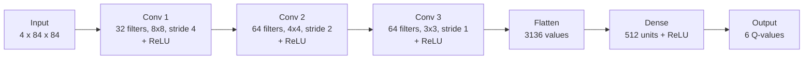
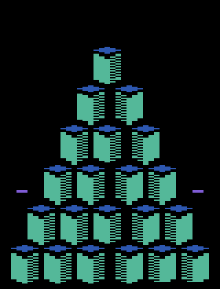

# Formative 3 – DQN Atari Project

We taught a computer program to play the Atari game **Q\*bert** using a Deep Q-Network (DQN). The program starts out knowing nothing. It plays the game again and again, sees which moves earned points, and slowly gets better.

The project is written in Python with PyTorch and Gymnasium. Packages are managed with **uv** only (no pip).

---

## 1. Project introduction

### Group members

| Member | Part of the project |
| --- | --- |
| Hikma Hamza | Game environment, image preprocessing and the neural network (CNN) |
| Silver (N-SilverJr) | Replay buffer, epsilon-greedy choice of moves, Bellman update, loss and target network |
| Ivan Kalisa | Training pipeline, logging, saving models, and the Task 3 experiments |
| Yvette Uwimpaye | Evaluation, gameplay demonstration, plots and documentation |

### Selected Atari environment

**`ALE/Qbert-v5`**. In Q\*bert you control a character that jumps around a pyramid of cubes. Landing on a cube changes its colour, and you score points when you change them all while dodging enemies. The game has **6 possible actions** (for example: do nothing, jump in each of the four diagonal directions, and fire).

The game images are made smaller before the network sees them:
- turned to grey (colour is not needed),
- shrunk to 84 × 84 pixels,
- the last **4 frames** are stacked together, so the network can see which way things are moving.

So each input to the network is a block of shape `4 × 84 × 84`.

---

## 2. DQN architecture

### The network

The network looks at the 4 stacked frames and gives back **6 numbers**, one for each action. Each number is a guess of how good that action is (called the *Q-value*). The agent normally picks the action with the biggest number.



| Layer | Output size |
| --- | --- |
| Input | 4 × 84 × 84 |
| Conv 1 (32 filters, 8×8, stride 4) | 32 × 20 × 20 |
| Conv 2 (64 filters, 4×4, stride 2) | 64 × 9 × 9 |
| Conv 3 (64 filters, 3×3, stride 1) | 64 × 7 × 7 |
| Flatten | 3136 |
| Dense + ReLU | 512 |
| Output | 6 |

The network has about **1.69 million** numbers to learn. The code is in `dqn.py`.

### Two copies of the network

During training we keep two copies:
- the **online network**, which is the one being trained at every update;
- the **target network**, a frozen copy that is refreshed every 2,000 steps. It gives steadier goals to aim for, so learning does not chase its own tail.

### The other parts

| Part | What it does | File |
| --- | --- | --- |
| Replay buffer | Remembers the last 20,000 moves. Training uses random samples from it, which stops the agent from learning only from what just happened. | `replay_buffer.py` |
| Epsilon-greedy | Sometimes picks a random move (to explore), sometimes the best-looking one (to use what it learned). | `dqn_agent.py` |
| Bellman update | Builds the goal for each move: reward now + `gamma` × best value expected next. | `dqn_agent.py` |
| Loss | Huber loss compares what the network guessed with that goal. | `dqn_agent.py` |

---

## 3. How training works

In plain steps, this is what `train.py` does:

1. **Start the game** and let the agent pick moves. At first almost every move is random (`epsilon = 1.0`).
2. **Save each move** (what it saw, what it did, the reward, what happened next) in the replay buffer.
3. **After 2,000 steps** of collecting, start learning. Every 4 game steps, take a random batch of 32 saved moves and nudge the network so its guesses move closer to the Bellman goal.
4. **Slowly make it less random.** Epsilon goes down in a straight line from 1.0 to 0.1 over the first 100,000 steps, so the agent relies more and more on what it has learned.
5. **Every 2,000 steps**, copy the online network into the target network.
6. **Log everything** (rewards, episode lengths, loss) to CSV files, draw a plot, and save the final model.

Rewards are clipped to between −1 and 1, as in the original DQN paper, so big scores do not make training unstable.

### Our ten experiments (Task 3)

All ten experiments use the same game, the same network and the same budget of **100,000 steps**. Each one changes **one hyperparameter** from the baseline (EXP01), so we can see what that change does.

| Experiment | What changed from the baseline |
| --- | --- |
| EXP01 | Baseline: learning rate 1e-4, gamma 0.99, batch 32, epsilon 1.0 → 0.1 over 100,000 steps |
| EXP02 | Learning rate 5e-5 (smaller) |
| EXP03 | Learning rate 2.5e-4 (bigger) |
| EXP04 | Gamma 0.95 (cares less about the far future) |
| EXP05 | Gamma 0.995 (cares more about the far future) |
| EXP06 | Batch size 64 |
| EXP07 | Batch size 16 |
| EXP08 | Epsilon start 0.9 |
| EXP09 | Epsilon end 0.05 |
| EXP10 | Epsilon decay over 50,000 steps (explores for less time) |

The full numbers are in [`IvanHyperparameter_experiment_results.md`](IvanHyperparameter_experiment_results.md).

**Result in short:** when we let every saved model play the same 10 games using only its best move (no randomness), **EXP04 (gamma 0.95)** scored highest with an average of about 485 points. Training rewards alone were noisy and gave a different order, so we trust the evaluation more. Even so, with only 100,000 steps the agent is still an early learner, and the scores vary a lot from game to game.

---

## 4. Gameplay demonstration

Here is our best agent (**EXP04**, gamma 0.95) playing one full game with no random moves. This game ended with a score of **675**.



The same game as a video (about 20 seconds): [`demo/ivan_best_agent_EXP04.mp4`](demo/ivan_best_agent_EXP04.mp4). If your browser will not play it, download the file and open it with any video player.

How the clip was made: the agent played 10 games with the same seeds as our evaluation, and `record_demo.py` saved the game with the highest score. It is not a hand-picked or edited clip, but it is the best of 10, so it looks better than the average game (the average was about 485).

```bash
uv run python record_demo.py        # records the video and GIF again
```

To watch a trained model play yourself (a game window opens):

```bash
uv run python play.py --model models/ivan/TASK3_EXP04.pth --episodes 3
```

To run without the window and just print the scores:

```bash
uv run python play.py --model models/ivan/TASK3_EXP04.pth --episodes 5 --no-render
```

The agent always picks its best-looking action here (epsilon = 0).

---

## 5. How to run the project

Install [uv](https://docs.astral.sh/uv/), then from the project folder:

```bash
uv sync                                          # install everything
uv run python test_dqn.py                        # quick tests
uv run python run_experiments.py --list          # show the 10 experiments
uv run python run_experiments.py --experiment TASK3_EXP01   # run one
uv run python run_experiments.py --all           # run all ten (takes hours)
uv run python evaluate_experiments.py --episodes 10   # compare saved models fairly
```

Finished experiments are skipped, so running a command twice will not erase old results. See `INSTRUCTIONS.md` for more detail.

---

## 6. What is in this repository

```
train.py                  training loop
play.py                   watch / test a trained model
run_experiments.py        runs the ten experiments and builds the results table
evaluate_experiments.py   fair comparison of the ten saved models
record_demo.py            records the gameplay video and GIF
demo/                     gameplay video (mp4) and GIF of the best agent
dqn.py                    the neural network
dqn_agent.py              epsilon-greedy, Bellman update, loss, target network
replay_buffer.py          memory of past moves
environment.py            Q*bert setup and image preprocessing
models/ivan/              saved trained models, one per experiment
plots/ivan/               training plots, one per experiment
results/ivan/             logs (CSV) and summaries (JSON) for every run
IvanHyperparameter_experiment_results.md   results table
PROJECT_GUIDE.md          shared team rules
```

The `checkpoint_step_*.pth` files that training saves along the way are not uploaded because they are large. The final models are.
