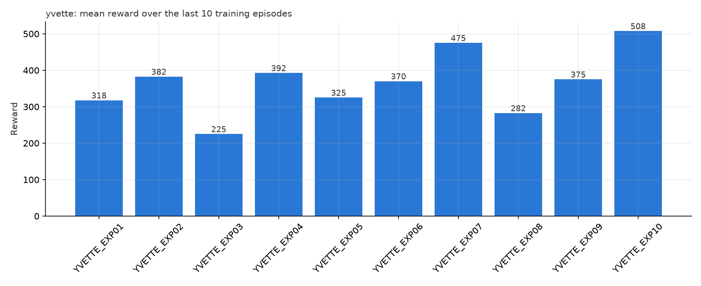
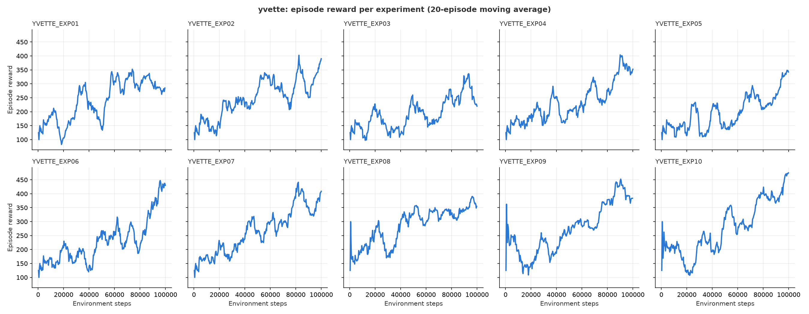

# Hyperparameter Experiment Results – Yvette Uwimpaye (Member 4)

**Environment:** `ALE/Qbert-v5` (84×84 grayscale, 4 stacked frames, frame skip 4)
**Training budget:** 100,000 environment steps per experiment (same as all team members)
**Fixed settings (team defaults in `train.py`):** replay buffer 20,000, learning starts at 2,000 steps, one update every 4 steps, target network synced every 2,000 steps, Adam optimizer, linear epsilon schedule, seed 42
**Hardware:** Google Colab (T4 GPU)

**How results are measured:** "Last 10 mean" is the average reward of the final 10 training episodes; "Best" is the highest single-episode reward during training. Both are taken from `results/yvette/<experiment>/episodes.csv`.

**Design:** EXP01 is the baseline (team defaults). EXP02–EXP08 each change **one** hyperparameter from the baseline. EXP09 differs from EXP08 only in epsilon end, and EXP10 combines the two best settings found by Hikma (learning rate 0.0002 and epsilon decay 75,000), which she only tested separately. None of these configurations repeat Hikma's ten.

## Experiment table

| Experiment | Learning rate | Gamma | Batch size | Epsilon start | Epsilon end | Epsilon decay | Observed behaviour |
|---|---|---|---|---|---|---|---|
| 1 (EXP01) | 0.0001 | 0.99 | 32 | 1.0 | 0.1 | 100,000 | **Baseline. Last 10 mean 317.5, best 925.** Slow, steady improvement. Epsilon only reaches 0.1 at the very last step, so the agent was still acting partly at random for most of training. |
| 2 (EXP02) | **0.0005** | 0.99 | 32 | 1.0 | 0.1 | 100,000 | **382.5, best 1025.** Better than baseline: larger update steps let the network learn faster within the short budget. Rewards were noisier, with bigger swings between episodes. |
| 3 (EXP03) | **0.00003** | 0.99 | 32 | 1.0 | 0.1 | 100,000 | **225.0, best 1075. Worst configuration.** Learning rate too small: the network barely changed in 100k steps, so most episodes stayed at 25–300. The one high peak was luck, not a learned policy. |
| 4 (EXP04) | 0.0001 | **0.95** | 32 | 1.0 | 0.1 | 100,000 | **392.5, best 875.** Better than baseline. Q*bert gives reward quickly (25 points per cube colour change), so a shorter-sighted agent still sees useful rewards, and the targets are less noisy. |
| 5 (EXP05) | 0.0001 | **0.995** | 32 | 1.0 | 0.1 | 100,000 | **325.0, best 750.** About the same as baseline. Valuing rewards far in the future makes Q-values larger and harder to estimate, which gave no benefit in only 100k steps. |
| 6 (EXP06) | 0.0001 | 0.99 | **16** | 1.0 | 0.1 | 100,000 | **370.0, best 875.** Slightly better than baseline, but less stable: each update uses fewer samples, so gradient estimates are noisier. |
| 7 (EXP07) | 0.0001 | 0.99 | **64** | 1.0 | 0.1 | 100,000 | **475.0, best 1450 (highest episode of all runs). 2nd best.** A larger batch gives a more reliable gradient estimate per update, so learning was steadier. |
| 8 (EXP08) | 0.0001 | 0.99 | 32 | 1.0 | 0.1 | **50,000** | **282.5, best 850.** Worse than baseline. Epsilon hit 0.1 halfway through, and rewards then flattened at roughly 250–400: the agent stopped exploring before it had learned enough. |
| 9 (EXP09) | 0.0001 | 0.99 | 32 | 1.0 | **0.02** | **50,000** | **375.0, best 800.** Better than EXP08, which only differs in epsilon end. With fewer random actions late in training, the agent fell off the pyramid less often, giving more consistent episodes (mostly 250–700). |
| 10 (EXP10) | **0.0002** | 0.99 | 32 | 1.0 | 0.1 | **75,000** | **507.5, best 1025. Best configuration.** Combining a higher learning rate with moderately faster exploration decay worked better than either change alone (Hikma: 437.5 and 417.5). Late-training episodes were regularly 600–1000. |

## Best and worst configurations

- **Best: EXP10** (lr 0.0002, epsilon decay 75,000), last 10 mean **507.5**. Second best: **EXP07** (batch size 64), **475.0**.
- **Worst: EXP03** (lr 0.00003), last 10 mean **225.0**.

## What helped and what hurt

- **Learning rate:** the most important setting within 100k steps. Too small (EXP03) means the network barely learns. Larger values (EXP02, EXP10) learn faster, at the cost of noisier rewards.
- **Epsilon decay:** there is a balance. Decaying over the full 100k steps (baseline) keeps the agent exploring too long, but decaying in 50k steps (EXP08) stops exploration too early. 75k (EXP10, and Hikma's EXP09) worked best.
- **Epsilon end:** matters once epsilon has reached it. In EXP09, a lower final epsilon (0.02) reduced random suicidal jumps in Q*bert.
- **Batch size:** larger batches (64) gave steadier learning than 16 or 32.
- **Gamma:** small effect here. 0.95 did slightly better than 0.99, and 0.995 gave no gain. Because Q*bert's rewards are frequent, a long horizon is less necessary over a short training run. Hikma's lower gamma values did not improve on the baseline, so this result is not conclusive.

## Final configuration and justification

**Chosen configuration: EXP10.** Learning rate 0.0002, gamma 0.99, batch size 32, epsilon 1.0 → 0.1 over 75,000 steps.

It had the highest final reward and the strongest late-training episodes. It is also backed by two independent results: Hikma's experiments showed each of these two changes helping on its own, and EXP10 shows they help even more together. A next step would be to add batch size 64 (my second-best single change) to this configuration and train for longer.

## Greedy evaluation of the best model

YVETTE_EXP10 was evaluated with `play.py` over 10 episodes, always taking the highest-Q action (no exploration):

| Metric | Value |
|---|---|
| Mean reward | **432.5** |
| Lowest / highest episode | 200 / 900 |
| Mean episode length | 545 steps |

Every episode scored at least 200, so the learned policy is consistent rather than lucky. This is about 2.7× the score of a random agent (about 160).

## Limitations

- **Short training:** 100,000 steps is very short for Atari DQN, which is usually trained for millions of steps. All agents are still improving at the end.
- **Single seed:** each configuration was run once, so differences of about 50 points may be partly due to chance.
- **Noisy measure:** the last-10-episode mean jumps around a lot, so it should be read together with the reward curves. Evaluating each model greedily with `play.py` over several episodes would give a fairer comparison.